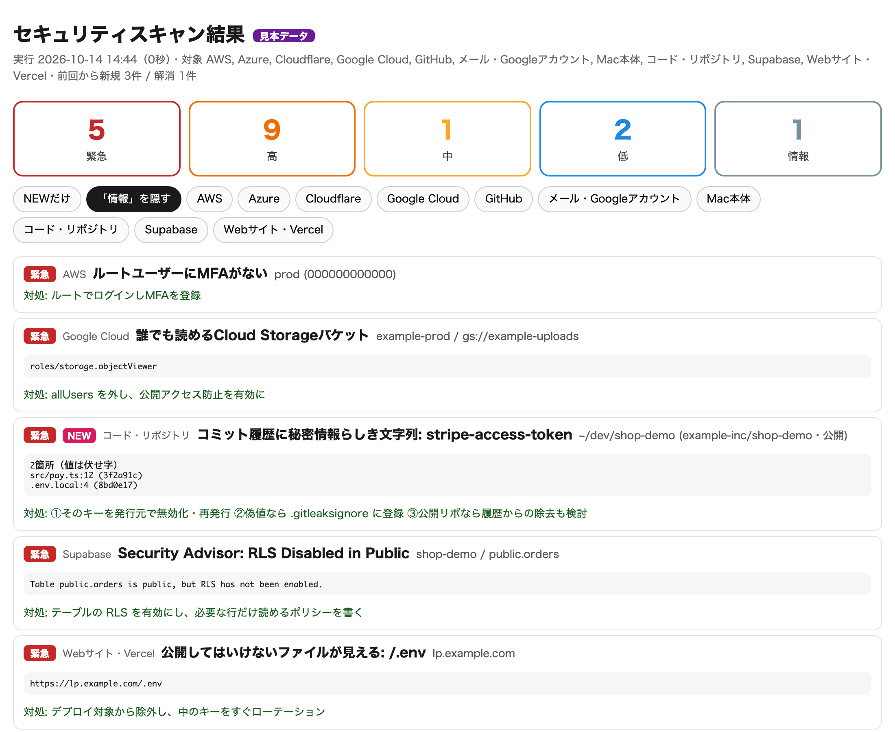

# claude-security-scan

**「セキュリティチェックして」の一言で、自分の開発環境をまるごと点検する Claude Code スキル。**

Mac・手元の全gitリポジトリ・GitHub・Vercelと公開サイト・クラウド（AWS / Google Cloud / Azure / Cloudflare / Supabase）・Gmail を**読み取り専用**で横断スキャンし、
重要度別のレポートと「前回から増えたもの」を出します。設定の書き換え・送信・削除は一切しません。



> **Claude Code・Codex をマスターしたい方へ**　非エンジニア向けハンズオン講座（講義5時間25分・資料180ページ・Skill配布キット付き）のアーカイブを note で公開しています → [note を見る](https://note.com/chaen_channel/n/na50320645814)
>
> **法人の方へ**　会社全体のセキュリティを一度プロに見てほしい場合は、株式会社デジライズのセキュリティ診断からご相談ください → [法人のご相談はこちら](https://security.digirise.ai/?utm_source=github&utm_medium=readme&utm_campaign=security-scan-oss#consult)

## なぜ作ったか

最近の情報漏えいは、高度な攻撃より「うっかり」から起きています。

- コミット履歴に残ったままのAPIキー
- 本番に一緒に上がってしまった `.env`
- MFAの無いクラウドの管理者アカウント
- 2段階認証を必須にしていない GitHub の組織
- 乗っ取られたメールに仕込まれた自動転送

どれも、見に行けば数秒で分かります。ただ、確認する場所が散らばっていて、毎週全部を見て回る人はいません。
それを Claude Code に任せるためのスキルです。

## 何を見るか

| 領域 | 主なチェック |
|---|---|
| Mac本体 | FileVault・ファイアウォール・Gatekeeper・SIP・自動ログイン・画面ロック・未適用アップデート・外から接続できるポート・~/.ssh の権限・常駐プログラム（root権限の常駐が、書き換え可能な場所や未署名のプログラムを起動していないか） |
| コード | 手元の全gitリポジトリのコミット履歴にある秘密情報（[gitleaks](https://github.com/gitleaks/gitleaks)・値は伏せ字）・`.env` のgit登録・依存パッケージの既知脆弱性（[osv-scanner](https://github.com/google/osv-scanner)） |
| GitHub | 本人と所属組織の2FA・2FA必須設定・未設定のメンバー・公開リポ作成権限・外部コラボレーター・Webhook・Dependabot / Secret scanning のアラート |
| Webサイト・Vercel | 全チームの本番ドメイン: HTTPS・証明書期限・セキュリティヘッダー・`.env` / `.git` の露出・プレビューURLの保護・ブラウザに出てしまう秘密っぽい環境変数 |
| AWS | ルートのMFA・MFAの無いIAMユーザー・放置されたアクセスキー・公開S3・CloudTrail・GuardDuty・全開放の管理/DBポート・公開RDS |
| Google Cloud | allUsers に付いた権限・個人Gmailへのオーナー権限・サービスアカウントの鍵・公開バケット・全開放のファイアウォール・全開放のCloud SQL |
| Azure | 匿名公開を許すストレージ・HTTPを受け付けるストレージ・全開放のNSG（管理/DBポート）・全開放のAzure SQL・Defender for Cloud |
| Cloudflare | SSL/TLSのモード（Off / Flexible）・Always Use HTTPS・最小TLS・DNSSEC・2段階認証の無いメンバー |
| Supabase | 公式 Security Advisor の診断（RLSの無い公開テーブル・security definer のビュー など） |
| Gmail | 自動転送・転送フィルタ・警告メールを隠すフィルタ・委任・最近のセキュリティ通知（件名だけ） |

入っているCLIと、設定したAPIトークン（Cloudflare・Supabase）だけを使います。無いものは「確認できなかった項目」に理由つきで出るだけで、止まりません。
**「確認できなかった」を「問題なし」と混同しない**のがこのツールの方針です。

## 導入

```bash
git clone https://github.com/chaenmasahiro0425/claude-security-scan ~/.claude/skills/security-scan
bash ~/.claude/skills/security-scan/scripts/install-tools.sh   # gitleaks と osv-scanner を取得（SHA256を検証）
```

あとは Claude Code で **「セキュリティチェックして」** と言うだけです。

必要なもの: Python 3.11 以上。各領域を見るには、それぞれのCLIにログインしておきます（入っているものだけでOK）。

| 領域 | 準備 |
|---|---|
| GitHub | `gh auth login` |
| Vercel | `vercel login` |
| AWS | `aws configure` または `aws sso login` |
| Google Cloud | `gcloud auth login`（閲覧者 roles/viewer 相当の権限） |
| Azure | `az login`（閲覧者 Reader 相当の権限） |
| Cloudflare | 読み取り専用のAPIトークンを `CLOUDFLARE_API_TOKEN` に export |
| Supabase | `supabase login`。RLSなどの診断は `SUPABASE_ACCESS_TOKEN` を export |
| Gmail | [gog](https://github.com/steipete/gogcli) で `gog auth add you@example.com` |

## 使い方

Claude Code から:

> セキュリティチェックして
> 前回から新しく出たリスクだけ教えて
> 直せるところある？
> 毎週月曜にスキャンするようにして

ターミナルから:

```bash
python3 ~/.claude/skills/security-scan/scan.py                # 全部
python3 ~/.claude/skills/security-scan/scan.py --skip repos   # 重いコード検査を外す
python3 ~/.claude/skills/security-scan/scan.py --demo --open  # 見本データで見た目だけ確認
bash ~/.claude/skills/security-scan/scripts/install-schedule.sh   # 毎週月曜 8:00 に自動実行（macOS）
```

結果は `reports/<日時>/report.html`（重要度・領域・NEWだけで絞り込み）に保存されます。

## 安全のための作り

- **読み取りだけ**: gog は `--readonly`、各クラウドは list / get / describe と API の GET だけ、Webサイトへも GET だけ
- **秘密の値を残さない**: gitleaks は `--redact`、Vercelの環境変数は名前と種類だけ、AWSのキーIDは末尾4桁、常駐プログラムの起動引数は記録しない。エラー文も伏せ字にしてから保存
- **見えなかったものを「解消」にしない**: 取得に失敗した範囲（アカウント・組織・リポジトリ単位）の指摘は、前回との比較で「解消」にも「新規」にも数えない
- レポートは自分のPCにだけ保存（権限700）。弱点の一覧なので共有に注意してください

## 設定（任意）

無くても動きます。対象を絞りたいときだけ [`config.example.toml`](config.example.toml) を
`~/.config/security-scan/config.toml` にコピーして編集してください。

## 制限

- Google Workspace 全体の管理設定（社員の2段階認証の強制など）は Admin API の委任が必要なため対象外です
- AWS のリージョン単位の検査（セキュリティグループ・RDS・GuardDuty）は、既定で東京（ap-northeast-1）とバージニア（us-east-1）だけです。ほかのリージョンを使っている場合は設定の `[aws] regions` に足してください
- 外部サイトへの攻撃的な検査（総当たり・ファジング）はしません。自分が管理するサイトだけを対象にしてください
- 検出は手がかりです。最終判断と修正は人が行ってください

## 改善・追加を歓迎します

オープンソースです。「このクラウドにも対応してほしい」「この検査は誤検知が多い」「こういう漏えいの入口も見たい」など、
Issue・Pull Request で気軽に提案してください。手順は [CONTRIBUTING.md](CONTRIBUTING.md) にあります。

## もっと使いこなしたい方・法人の方へ

- **Claude Code・Codex をマスターするなら**：このスキルの作り方（Skill・hooks・CLAUDE.md / AGENTS.md の設定）まで学べるハンズオン講座のアーカイブ → [note](https://note.com/chaen_channel/n/na50320645814)
- **法人のセキュリティのご相談**：サイトの無料診断から、詳しい診断・対策・AIセキュリティ教育まで → [デジライズ セキュリティ診断（ご相談フォーム）](https://security.digirise.ai/?utm_source=github&utm_medium=readme&utm_campaign=security-scan-oss#consult)

## ライセンス

MIT
